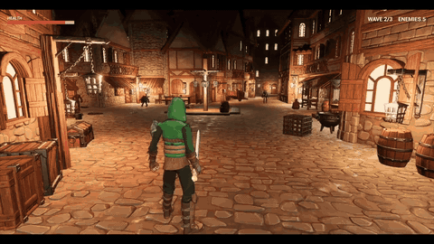

# Slash

[](Media/slash.mp4)

A third-person melee action game made in Unreal Engine 5.8 with C++.

You play a hooded ranger with a sword, fighting three waves of monsters through a lantern-lit medieval street at night. The combat takes a lot from God of War (2018): a tight over-the-shoulder camera, heavy combo swings that lunge you onto whoever you're facing, and enemies that take turns attacking and keep themselves in front of the camera.

## Features

- **Combos:** light, heavy and aerial sword chains defined in a data asset, so hits can be added or tuned without code.
- **Hit detection:** the blade sweeps between frames so fast swings never pass through enemies.
- **Dodge roll:** an invulnerable roll that cancels attacks and flinches.
- **Lock-on:** targets whoever you're looking at, weighted by angle and distance.
- **Monsters:** Imps and Puglins with claw, bite and pounce attacks and eyes that flare before they strike.
- **Encounter director:** keeps enemies on an arc in front of the camera and lets only one attack at a time.
- **Game loop:** a title screen, three waves, victory and defeat screens, and pause, with all UI built in C++.
- **Camera:** blended camera profiles for walking, sprinting, combat and air.

## Getting started

You need:

- Unreal Engine 5.8
- A C++ toolchain: Xcode on macOS, or Visual Studio 2022 with the game development workload on Windows
- [Git LFS](https://git-lfs.com), since all the assets are stored with it

Clone it:

```bash
git lfs install
git clone https://github.com/GaminRick7/slash-ue5.git
```

Then open `Slash.uproject`. Unreal will ask to build the `Slash` module the first time; say yes. If that fails, build it yourself.

On macOS:

```bash
"/Users/Shared/Epic Games/UE_5.8/Engine/Build/BatchFiles/Mac/Build.sh" SlashEditor Mac Development -project="$PWD/Slash.uproject"
```

On Windows, right-click `Slash.uproject`, choose **Generate Visual Studio project files**, then build `SlashEditor` in the Development Editor configuration.

The game starts on `L_Arena_Combat`. Press Play and then Start on the title screen.

It has only been built and tested on macOS so far.

## Credits

- Characters, monsters, animations, village and props: [Quaternius](https://quaternius.com) (Universal Animation Library, Modular Character Outfits, Medieval Village MegaKit, Fantasy Props MegaKit, Bestiary)
- Built with [Unreal Engine](https://www.unrealengine.com)
